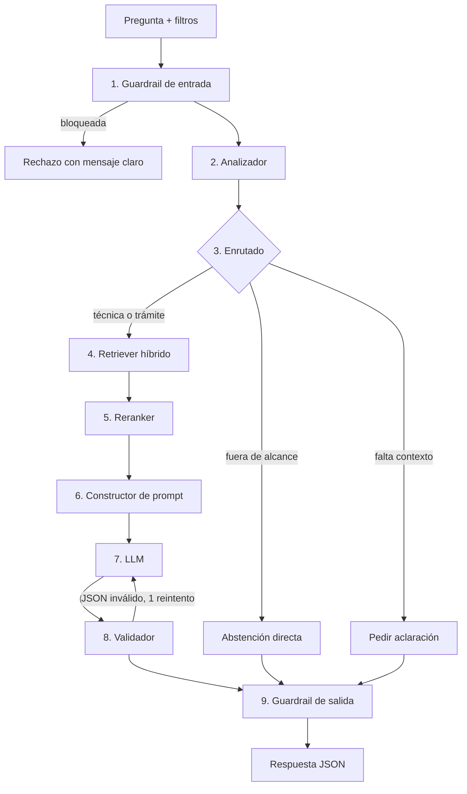

# 1.3 · Componentes de la cadena

## Diagrama

Todos los pasos quedan registrados en una traza de MLflow (RF-10), con la pregunta enmascarada (T-09).

## Componentes

| # | Componente | Tipo | Entrada | Salida | Si falla | Tareas 1.2 |
|---|---|---|---|---|---|---|
| 1 | Guardrail de entrada | Código + clasificación | Pregunta y filtros | Pregunta aceptada o rechazo | Rechazo con mensaje claro; no se llama al LLM | T-04 |
| 2 | Analizador | LLM (salida estructurada) | Pregunta aceptada | tipo (técnica/trámite), instalaciones, niveles, en_alcance, motivo | Seguir sin filtros extra y con tipo «técnica» | T-01, T-02, T-03 |
| 3 | Enrutado | Código | Salida del analizador y filtros del usuario | Camino: abstención, aclaración o búsqueda | — (reglas deterministas) | — |
| 4 | Retriever híbrido | Embeddings + BM25 | Pregunta y filtros de metadatos | Top 10 chunks con metadatos | Error claro «no se pudo buscar»; sin respuesta inventada | T-05, T-08 |
| 5 | Reranker | Modelo de re-ranking | Pregunta y 10 chunks | Top 5 chunks ordenados | Pasar los 10 chunks sin reordenar | T-06 |
| 6 | Constructor de prompt | Código | Pregunta, chunks y versión del prompt | Prompt con contexto delimitado y esquema JSON | — | — |
| 7 | LLM | Generación | Prompt | JSON de respuesta | Error de servicio: mensaje claro | T-07 |
| 8 | Validador | Código (Pydantic) | JSON del LLM y chunk_id recuperados | Respuesta validada | 1 reintento; si vuelve a fallar, abstención con motivo técnico | — |
| 9 | Guardrail de salida | Código | Respuesta validada | Respuesta final con avisos | Si detecta problema, añadir aviso o abstenerse | — |

## Qué comprueba cada guardrail y el validador
- **Guardrail de entrada:** pregunta no vacía y de 1000 caracteres como máximo (código); intento de inyección (clasificador).
- **Validador:** el JSON cumple el contrato Pydantic y cada cita apunta a un chunk_id que se recuperó de verdad, para que no haya citas inventadas.
- **Guardrail de salida:** las URL son de boe.es, aragon.es o zaragoza.es; no aparece «está vigente» sin fuente; se añaden siempre los avisos fijos (no es asesoramiento jurídico, fecha del corpus).

## Caminos
1. **Normal:** 1 → 2 → 3 → 4 → 5 → 6 → 7 → 8 → 9.
2. **Abstención temprana** (UNE, Huesca, cálculos): 1 → 2 → 3 → abstención → 9. No se busca ni se llama al LLM de generación, así que es más barato y no puede inventar.
3. **Aclaración** (pregunta ambigua): 1 → 2 → 3 → pedir aclaración → 9, con `abstencion.contexto_solicitado` relleno.
4. **Bloqueo:** 1 → rechazo.

## Llamadas a LLM por consulta
- Camino normal: 2 (analizador + generación), 3 si hay reintento.
- Abstención temprana o aclaración: 1 (solo el analizador).